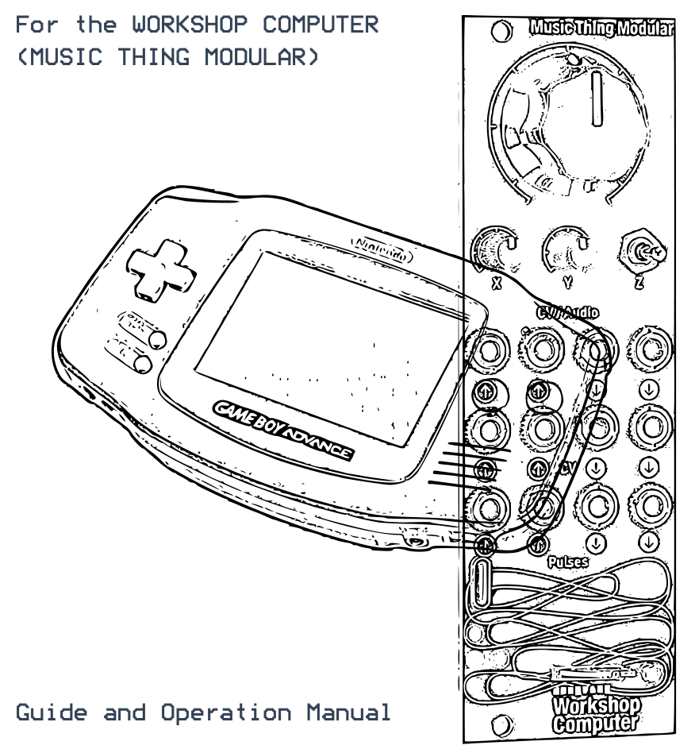
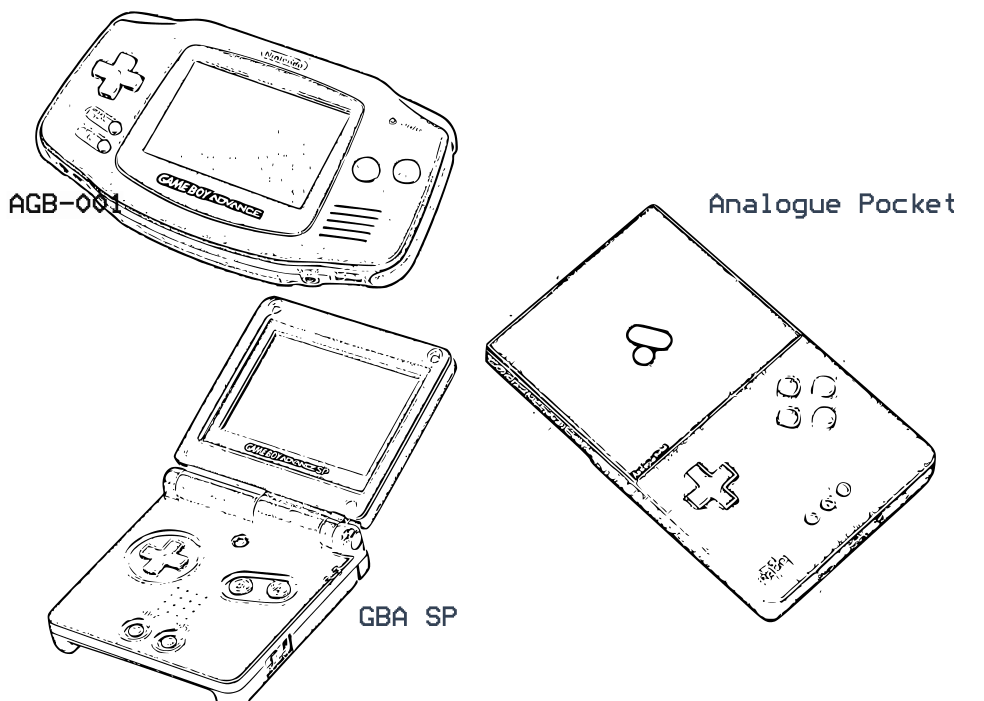
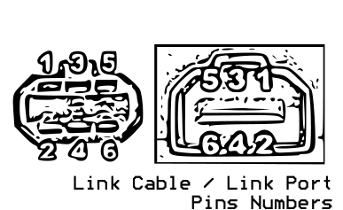

# GBA FM Voice

A program card for the Music Thing Modular **Workshop Computer** that turns a **Game Boy Advance**
into an **FM synth for your modular**: two 2-operator voices, or one classic 4-operator voice, with a
drum mode either way.

The Workshop loads custom software onto the GBA through its link cable using the GBA's built-in
**multiboot**, so you need no cartridge and no modifications. From then on, signals flow both ways:
your CV, knobs and gates play the FM voices (and, if you like, two drums), and the GBA sends its
notes, gates and buttons back to the rack. Sound comes out of the GBA's headphone jack in stereo,
and the sound editor is on the GBA's own screen.

It is the sibling of **[GBA PSG Voice](https://github.com/uglifruit/89_GBA)**: the same cable, the
same loader, but instead of the GBA's four retro sound channels it computes FM sound in real time —
bells, electric pianos, plucks, basses, brass and a drum kit.

**[Technical guide](TECHNICAL.md)** ·
**[Program Card Firmware](UF2/gba_link.uf2)**

> **Beta.** Built and checked in a bit-exact model of its maths; hardware testing is under way.

---

## What you need

- **A Game Boy Advance, GBA SP or Analogue Pocket**, with **no cartridge in it**.
  The GBA SP has no headphone socket, so it needs Nintendo's SP headphone adapter.
- **A link cable** wired to the Workshop's pulse jacks, with two 1 kΩ resistors (see [below](#the-cable)).
  It is the same cable as GBA PSG Voice's.
- **The firmware**, [`UF2/gba_link.uf2`](UF2/gba_link.uf2), flashed to the Workshop Computer.

## Getting started

1. Connect the GBA to the Workshop with the link cable. Leave the cartridge slot empty.
2. Switch on the **Workshop Computer first**, then the **GBA**.
3. The Workshop's LEDs light in sequence as the software loads (about eight seconds).
4. The GBA screen goes green, then shows the **PLAY** screen.
5. Push the **Z switch down**. You should hear a note.

Sound comes from the **GBA's headphone jack**, in stereo. It is quiet by Eurorack standards, so
plug it into a mixer or another input with gain.

**Nothing happening?** Power-cycle the GBA and try again. You always need to do this after
re-flashing the Workshop. For fault codes and step-by-step checks, see the
[technical guide](TECHNICAL.md#if-it-does-not-work).

## The cable

| Pin | Signal | Connect to |
|-----|--------|------------|
| 1 | VDD | nothing |
| 2 | SO | **Pulse In 1** |
| 3 | SI | **Pulse Out 2**, through a **1 kΩ resistor** |
| 4 | SD | nothing |
| 5 | SC | **Pulse Out 1**, through a **1 kΩ resistor** |
| 6 | GND | ground |

- **Don't leave out the resistors.** The pulse outputs swing to about 6 V and the GBA runs at 3.3 V.
- **Use a Game Boy Color link cable** if you can. They have all six wires; many third-party GBA
  cables don't.
- **The two ends of a link cable may swap SO and SI.** If nothing connects, the
  [technical guide](TECHNICAL.md#making-a-cable-a-word-of-warning) has a diagnostic that tells you
  which wire is which.

## Connections

| Inputs | Default job |
|---|---|
| **CV In 2** | Voice 1 pitch, 1V/oct |
| **Pulse In 2** | Voice 1 gate |
| **Audio In 2** | Voice 2 pitch, 1V/oct · in drum mode, **Drum B** trigger |
| **Audio In 1** | Voice 2 gate · in drum mode, **Drum A** trigger |
| **CV In 1** | Voice 1 brightness (FM index) |
| **Pulse In 1** | GBA SO (link cable) |
| **Main knob** | brightness of both voices (and both drums) |
| **X knob** | Voice 1 C:M ratio |
| **Y knob** | decay and release of both voices |
| **Z switch** | down = trigger Voice 1, up = drone |

| Outputs | Job |
|---|---|
| **CV Out 1** | Voice 1 gate out |
| **CV Out 2** | Voice 1 pitch out (quantised, 1V/oct) |
| **Audio Out 1** | **A** button gate |
| **Audio Out 2** | **B** button gate |
| **Pulse Out 1** | GBA SC (link cable) |
| **Pulse Out 2** | GBA SI (link cable) |

The knobs are centred: **noon leaves the sound as the patch has it**. You can reassign every input
and knob on the GBA's **MAP** page.

---

## How FM works here

Each voice is two sine waves. The **modulator** bends the **carrier**, and you hear the carrier.

- **RATIO** sets the modulator's pitch as a multiple of the carrier's. Whole numbers give
  instrument-like tones; fractions like 1:3.5 give bells and clangs.
- **INDEX** sets how hard the modulator pushes: 0 is a pure sine, turning it up adds brightness,
  like opening a filter. The modulator has its own envelope, so a note can start bright and mellow.
- **FEEDBACK** turns the modulator toward a sawtooth; **NOISE** adds breath and hiss; **PITCH ENV**
  sweeps the pitch at the start of a note, for kicks, toms and zaps.

FM sounds are hard to build from nothing, so every voice has **presets** to start from:

| Tuned | Untuned |
|---|---|
| PLUCK, E.PIANO, BELL, TUBULAR, MARIMBA, VIBES, CLAV, GLASS, BASS, SUB BASS, BRASS, ORGAN, FLUTE, STRINGS, SAW LEAD, PAD | KICK, SNARE, CL HAT, OP HAT, TOM, RIM, COWBELL, METAL, ZAP, GONG |

## 4-op mode

Set **VOICE MODE** to **4-OP** on the SET page and the two 2-operator voices give way to **one
4-operator voice** in the classic Yamaha style (DX21, TX81Z): four operators, each with its own
ratio, level and envelope, arranged by one of **eight algorithms**, from a deep 4→3→2→1 stack to
four sine waves side by side. It plays from Voice 1's inputs (CV In 2 and Pulse In 2), and drum mode
still works alongside it.

It has its own presets, in the DX tradition:

| 4-op presets |
|---|
| E.PIANO, E.PIANO 2, BELL, TUBULAR, MARIMBA, VIBES, GLOCK, HARP, CLAV, BASS, SYN BASS, BRASS, STRINGS, PAD, ORGAN, FLUTE |

## Drum mode

Turn on **DRUM MODE** on the SET page, or give it a button on the BTN page. Voice 2 steps aside and
**Audio In 1 and Audio In 2 become two drum triggers**: Drum A (a kick by default) and Drum B (a
snare). The Workshop watches those jacks itself, so even a 1 ms trigger is caught.

Voice 1 carries on as normal, and it can play drum presets too: a KICK on Voice 1 is a tuned kick
that follows CV In 2.

---

## The GBA software

| Button | Does |
|---|---|
| **START** | open the editor / back to the PLAY page |
| **SELECT + Left/Right** | move between editor pages |
| **D-pad** | move around a page |
| **A + D-pad** | change a value |

### PLAY

The performance screen. It shows the note playing, a meter and preset name for each voice that is
sounding, Voice 1's ratio, index and feedback, and the live inputs and knobs. Here the **D-pad, A,
B and shoulder buttons** are for playing: trigger, hold, octave, ratio and feedback by default, all
set on the BTN page.

### MEM: patch memory

Sixteen patch slots, stored on the Workshop Computer. **D-pad** picks a slot, **A + Up** saves,
**A + Down** loads. GBA PSG Voice patches in the same slots show **BAD DATA** and are left alone.

> ⚠️ Saving overwrites the slot straight away. Check you are on the right slot first.

### FM: the voices

Pick a voice (Voice 1, Voice 2, Drum A, Drum B), then its preset, ratio, detune, index, feedback,
noise, pitch envelope, note, octave and portamento. Choosing a preset loads it straight away, so
scrolling the list auditions it. In 4-op mode, Voice 1 is the 4-op voice: its preset, algorithm,
operator 4's feedback, pitch envelope, note, octave and portamento.

### ENV: envelopes

Two envelopes per voice: **MOD INDEX** (brightness over the note) and **CARRIER** (volume). Attack,
decay, sustain and release, with the shape drawn as you edit it.

For the 4-op voice this page becomes an **operator grid**, one column per operator: ratio, detune,
level, attack, decay, sustain and release, with the algorithm drawn underneath. Carriers are shown
in green. On the RATIO row, **A + Up/Down** changes the coarse ratio and **A + Left/Right** the
fine. Move down past RELEASE to **ALG** and **FB**, beside the diagram, to change the algorithm and
operator 4's feedback right there.

### MIX: mixer

A fader per voice: level (0–15, 2.5 dB per step) and left / right panning.

### MAP: modulation

What each input does. Each source (CV 1, CV 2, Audio 1, Audio 2, Pulse 2 and the three knobs) gets
a destination, an amount, and a tickbox per voice. Destinations include pitch, gate, index, ratio,
level, feedback, noise, the envelope times and pan. An amount of +32 on PITCH is exactly 1V/oct.

### BTN: buttons

What each GBA button does on the PLAY page: trigger or hold either voice, octave, ratio, index,
feedback, step through presets, hit a drum, or turn drum mode on and off.

### SET: settings

Voice mode (two 2-op voices or one 4-op voice), drum mode, which voice the Z switch plays, and the
key, scale and tuning. Choose a scale to
quantise everything you play, and CV Out 2 becomes a quantiser for the rest of your rack. **FREE**
turns quantising off.

### CAL: calibration

Trims how CV In 2 and Audio In 2 track 1V/oct, each with its own scale, offset and live tuner. It
also shows the link state and how hard the sound engine is working. **You may need this page:**
every Workshop Computer's inputs are slightly different.

---

## More

- **[Technical guide](TECHNICAL.md)**: building the cable in detail, fault codes, every page in
  depth, how the FM engine and the link work, and how to build from source.
- **[BENCH.md](BENCH.md)**: step-by-step bring-up if it doesn't connect.
- **[diagnostics/](diagnostics/)**: link and cable test programs.

By **Andy Jenkinson** (YT/IG @uglifruity), 2026. Built on
Chris Johnson's ComputerCard library for Tom Whitwell's Music Thing Modular Workshop Computer.
MIT licensed.
